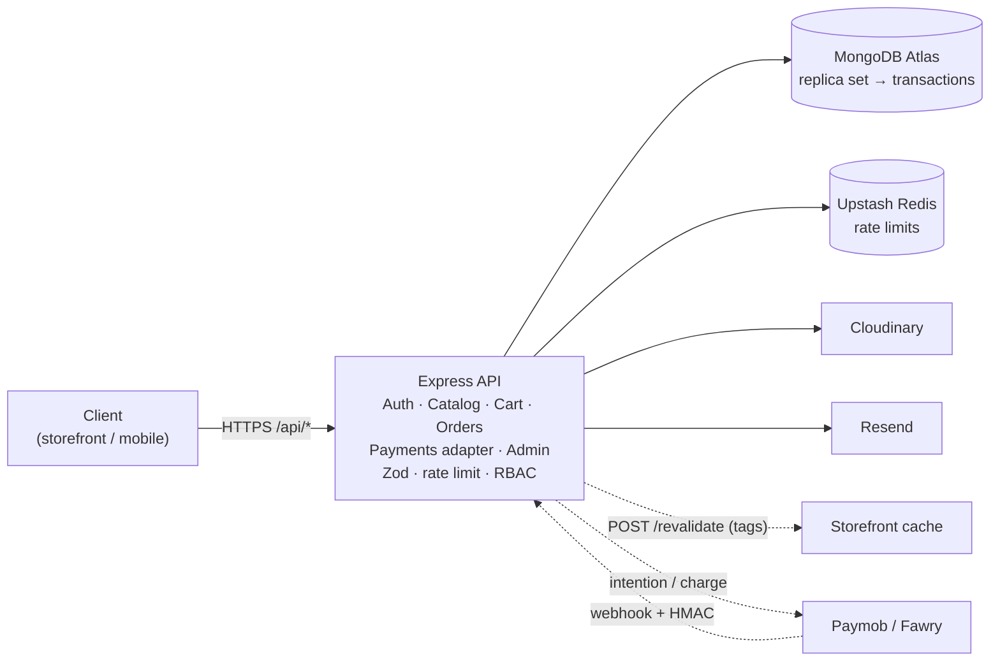

# Atelier API

REST API for **Atelier**, a multi-category, bilingual (Arabic / English) online store. Express 5 · Mongoose 9 · Zod 4 · TypeScript.
It is a standalone service: any client (the Next.js storefront, a mobile app…) talks to it over HTTP.

> The storefront + admin UI lives in its own repository: **MarketPlace-Front**. This repo needs nothing from it to run or deploy.

## What it does

- **Auth** — e-mail/password with verification, Google sign-in, 15-minute access tokens + httpOnly refresh cookie with **rotation and reuse detection**, password reset (15 min, single use), RBAC on every endpoint, a read-only `demo_admin` role.
- **Data-driven catalogue** — categories (3 levels) define attributes (`filterable`, `variantOption`, localized labels); products fill them in. Faceted listing, Arabic/English search + type-ahead, brands, collections, reviews (verified purchases only).
- **Cart & checkout** — guest-cart merge, server-side pricing, stock/price warnings, shipping by governorate, coupons, idempotent order placement.
- **Orders** — explicit state machine, transactional stock handling, cancellations/refunds restore stock, audit log.
- **Payments** — provider adapter (`PaymentProvider`): COD live, signed-webhook Mock gateway, Paymob/Fawry as "coming soon".
- **Back office API** — dashboard aggregates, orders, inventory with reasons, customers, coupons, shipping, CSV import, signed Cloudinary uploads.
- **Ops** — pino logs with request ids, Sentry, rate limiting (Upstash), OpenAPI docs at `/api/docs`.



## Quick start

Requires Node 22+ and a MongoDB **replica set** (transactions). Pick one:

```bash
docker compose up -d          # MongoDB replica set on :27017 + Mailpit (inbox UI :8025)
# or, Docker-free (in-memory, wiped on exit):
npm run dev:db                # → mongodb://127.0.0.1:27018/marketplace?replicaSet=rs0
```

```bash
npm install
cp .env.example .env          # set MONGODB_URI, JWT_ACCESS_SECRET (and APP_URL = your storefront URL)
npm run seed                  # 5 categories, 29 products, orders, coupons, demo accounts
npm run dev                   # http://localhost:4000 · docs: /api/docs · health: /health
```

Seeded accounts:

| Role | Login |
|---|---|
| Admin | `admin@atelier.test` / `Admin#12345` |
| Read-only reviewer | `demo@atelier.test` / `Demo#12345` |
| Customer | `customer@atelier.test` / `Demo#12345` |

Coupons: `WELCOME10`, `SAVE100`, `SUMMER25`.

## Project structure

A layered layout (routes → controllers → services → models), one folder per concern:

```
server.ts          starts the HTTP server (local dev / Docker)          npm run dev · npm start
app.ts             builds the Express app (middleware + routes + error handling)
handler.ts         serverless entry for Vercel (exports the handler, never calls listen)
config/            env (Zod-validated), constants, db (cached connection), logger, sentry, openapi
routes/            URL → controller wiring only (one file per resource) + routes/index.ts
controllers/       request handlers: read validated input, call a service, shape the response
services/          business logic — auth, cart, checkout, orders, inventory, payments/, email/ …
models/            Mongoose models, one per file: User, Product, Order, Session, …
middleware/        auth (JWT + RBAC), rate limit, validate (Zod), sanitize, error handling
validators/        Zod request schemas, shared by request validation and the OpenAPI docs
utils/             ApiError, money, text, crypto, slug, objectId, DTO mappers, background tasks
types/             Express type augmentation
scripts/           seed, dev-db (in-memory replica set), sync-indexes, build-vercel
test/              unit + integration tests (real MongoDB replica set in memory)
api/               Vercel function: index.js (entry) + _app.js (committed bundle)
```

Pure business rules (`orderStateMachine`, `pricing.service`, `couponRules.service`, `productBuilder.service`) do no I/O and are unit-tested;
controllers stay thin and delegate anything non-trivial to a service.

## Scripts

| | |
|---|---|
| `npm run dev` | API with reload (`server.ts`) |
| `npm run build` | bundles the app into `api/_app.js` (Vercel Function; **committed**) |
| `npm test` | unit + integration tests (real in-memory replica set) |
| `npm run lint` · `typecheck` | ESLint · `tsc --noEmit` |
| `npm run seed` | demo data (`-- --reset` wipes first; refuses in production without `--allow-production`) |
| `npm run indexes` | creates MongoDB indexes — **required once per environment** (production never auto-builds them) |

## Testing

99 tests across 9 files. Highlights:

- **Concurrency** — 10 simultaneous buyers, 1 unit left → exactly one order, stock never negative, one inventory log.
- **Idempotency** — the same `Idempotency-Key` sent 3× in parallel creates one order.
- **State machine** — every legal path, illegal jumps rejected even for admins, paid orders can only be refunded.
- **Auth** — rotation, replay of a stolen token revokes the whole family, concurrent refresh, reset-link single use/expiry, NoSQL-injection guard, rate limiting.
- **Webhooks** — valid / invalid / tampered signature, duplicate and concurrent deliveries, amount mismatch, late payment on a cancelled order.
- **Catalogue** — category-driven validation, facets, Arabic search, admin edits never clobber live stock.

## Deployment

See **[DEPLOY.md](./DEPLOY.md)** (Vercel + MongoDB Atlas, environment variables, troubleshooting).

## Engineering decisions

**Why cash on delivery first, and how does Paymob plug in without touching `orders`?**
Gateways need a verified merchant account; COD lets the commerce core ship and be proven first. `orders` only talks to the
`PaymentProvider` interface through `payment.registry.ts` (`createPayment`, `verifyWebhook`, `getStatus`, `refund`, `initialOrderStatus`).
COD, a signed-webhook Mock and `ComingSoon` placeholders already implement it; Paymob = one class + flipping `enabled`. The webhook is the source of truth:
verify the HMAC over the **raw** bytes → store the raw callback in `payment_events` → idempotent claim → compare amount/currency → only then `pending_payment → paid`.
Gateway I/O happens *after* the DB transaction commits, never inside it.

**How is overselling prevented?**
One conditional update — the check lives inside the write:
`updateOne({ variants: { $elemMatch: { sku, stock: { $gte: qty } } } }, { $inc: { 'variants.$.stock': -qty } })`.
`modifiedCount === 0` ⇒ insufficient stock ⇒ the whole multi-item transaction aborts. There is no read-then-write window. Proven by `concurrency.test.ts`.

**Why money in piasters, and why does an order snapshot prices?**
Integers avoid float errors; totals come from pure, unit-tested functions. Orders store a snapshot of title, localized options, unit price and address so catalogue edits never rewrite history.
The client's `expectedTotal` is checked at placement (`PRICE_CHANGED` instead of a surprise).

**How does the catalogue handle different attributes per category?**
A category defines attributes and children inherit them; a product only fills them in. `validateAndDerive` checks options/variants against the category and derives facet pairs,
price range and Arabic-normalised search keywords. Listing facets are one `$facet` aggregation built from those definitions. Adding a department is a data change.

**How does refresh-token rotation detect theft?**
Each refresh swaps the opaque token for a new one in the same *family* and marks the old one rotated. Presenting a rotated token again (attacker or stale client — indistinguishable) revokes the **entire family**.
The atomic "claim" also turns two concurrent refreshes into a reuse event, so clients must single-flight their refreshes.

**What breaks first at 10× traffic?**
Atlas connections (cached connection + small pools done; then upgrade tier), faceted listing over large categories (next: Atlas Search / precomputed facets),
write contention on a hot SKU (transactions retry; next: reservations with TTL). Rate limits already use shared Redis.

**What would I change starting over?** Generate client types from the OpenAPI document; add stock reservations with expiry before enabling online payments (stock is deducted at order creation, right for COD); an outbox for e-mails.

## Notes & limitations

- Phase-4 payments are partly built: adapter, Mock provider and webhook pipeline are tested; real Paymob/Fawry calls are not implemented.
- Refunds mark records and return stock; calling a gateway's refund API belongs to the Paymob/Fawry work.
- A banned user's access token stays valid until it expires (≤ 15 min); sessions are revoked immediately.
- E-mails are branded, bilingual HTML templates (no `@react-email`), and PDF invoices are not included.
